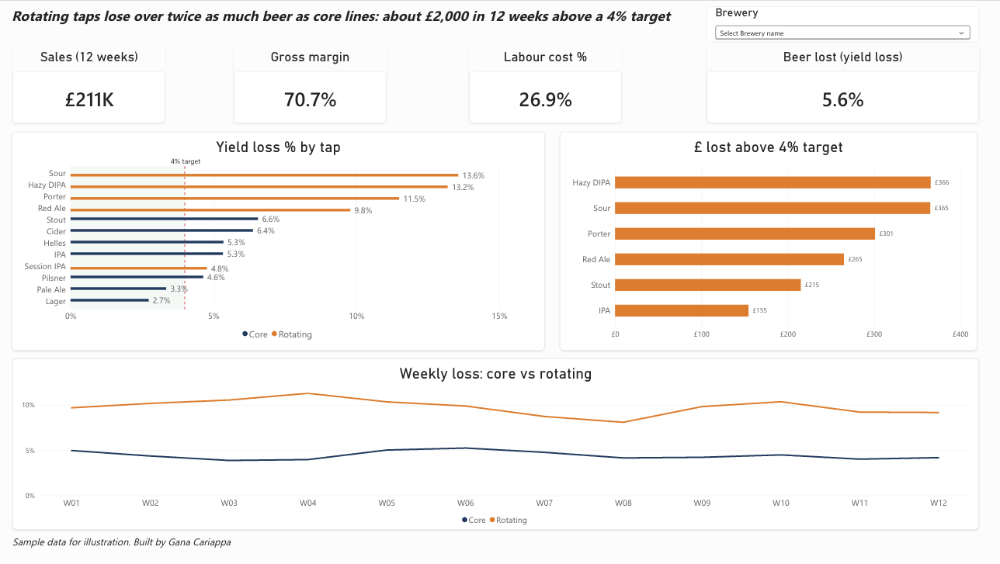
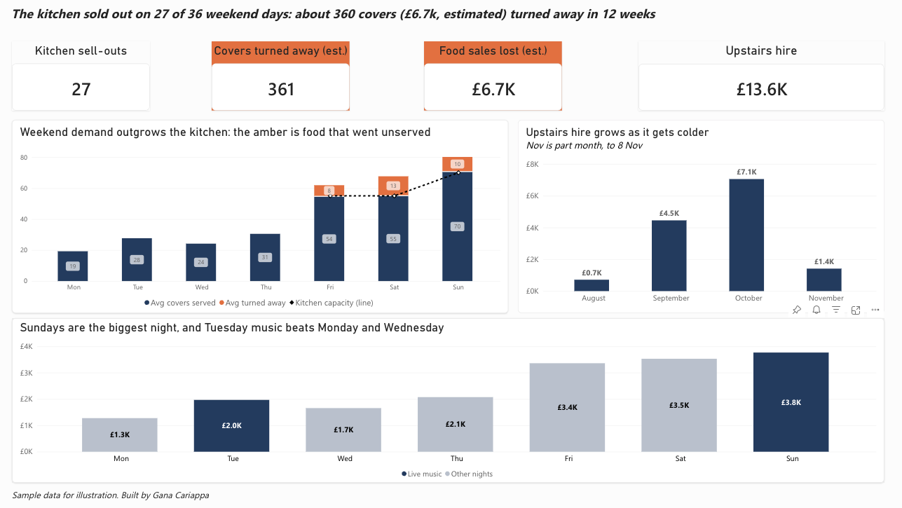

# Hospitality trading dashboard (Power BI)

A two-page Power BI report showing where a food-led pub loses money and where demand outgrows capacity. **All numbers are sample data for illustration.**

**At a glance**
- **Bar yield:** rotating beer taps waste over twice as much as core lines, costing about £2,000 above target in 12 weeks.
- **Kitchen capacity:** the kitchen sold out on 27 of 36 weekend days, turning away an estimated 360 covers (about £6.7k).

## Page 1: Where the bar loses stock

Compares stock poured with stock sold for each tap, against a 4% waste target.

## Page 2: Where demand beats capacity

Compares covers served with kitchen capacity by day, and shows room hire by month and sales on live-music nights.

## How it was built
- Power BI and Power Query, on a star schema of sales, product, stock and kitchen tables.
- Each page title states its finding, so a manager gets the answer before reading the charts.

Built by Gana Cariappa.
